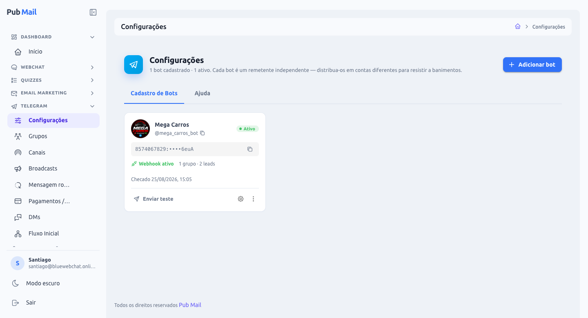
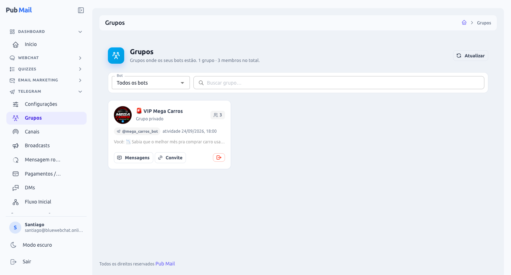
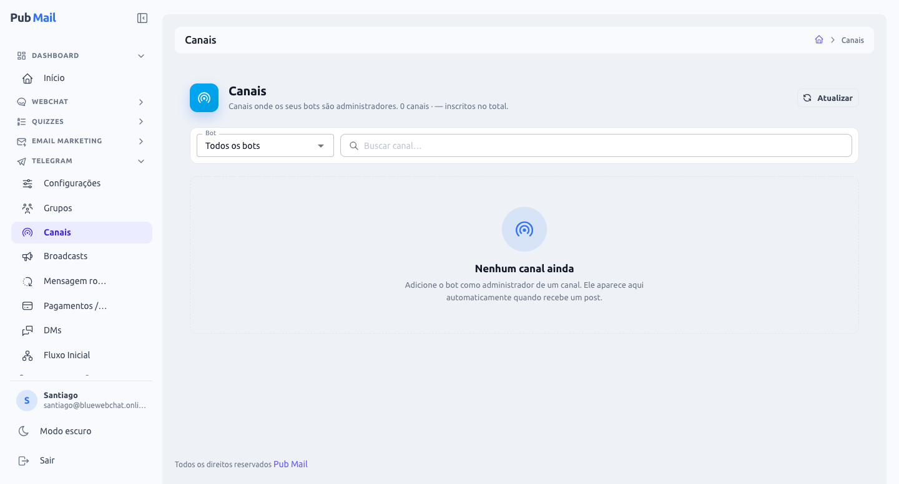
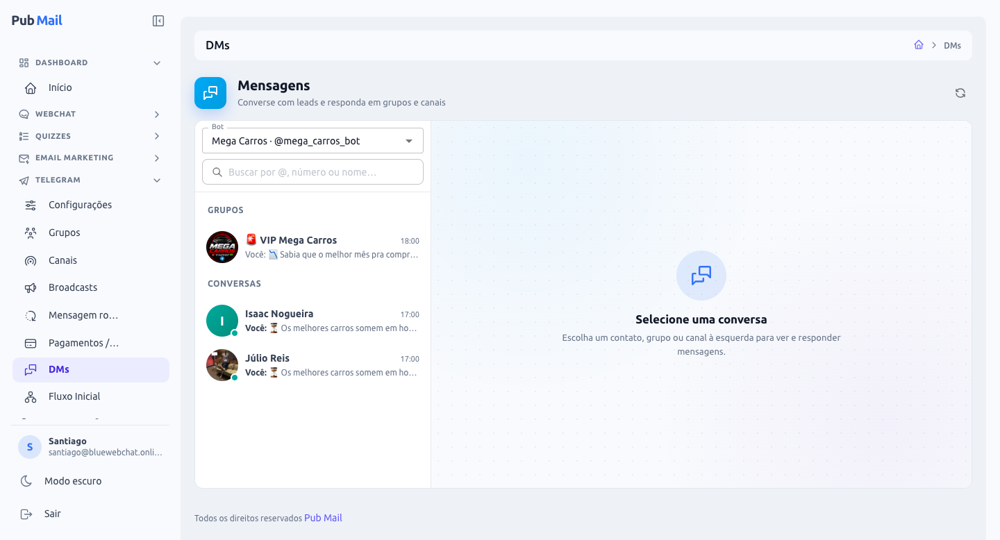
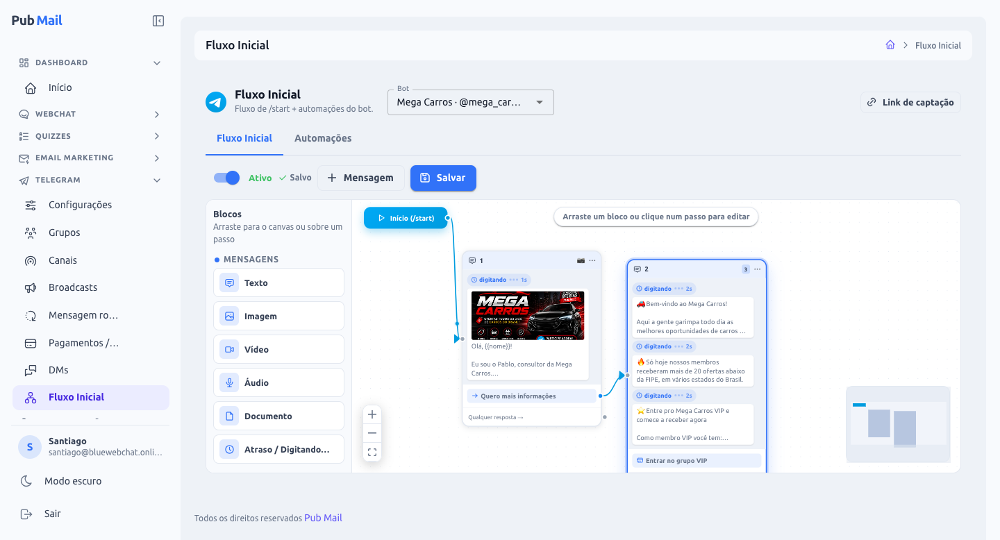
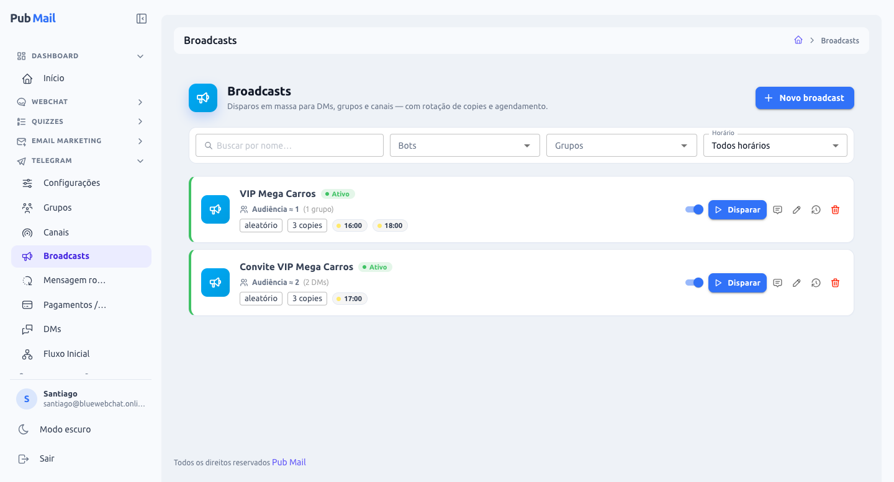
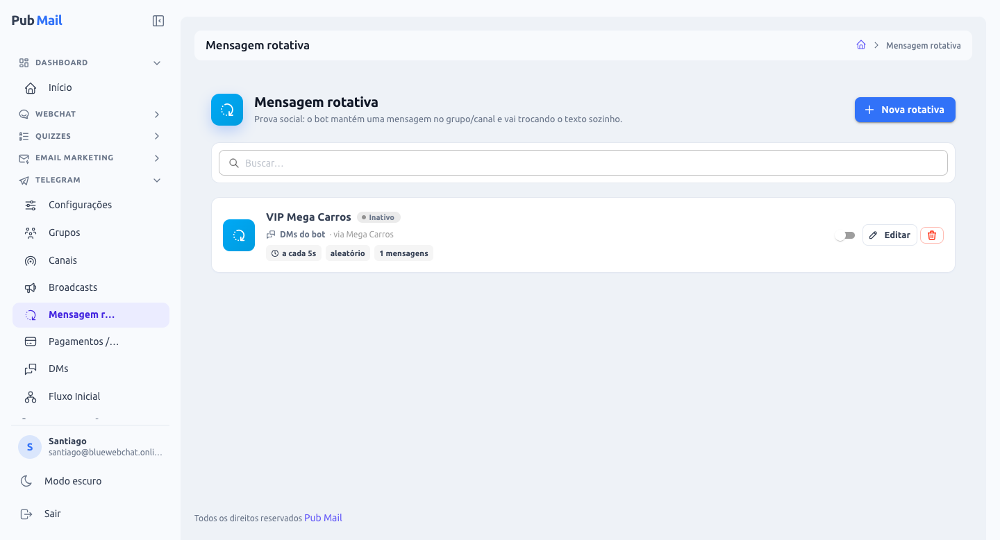
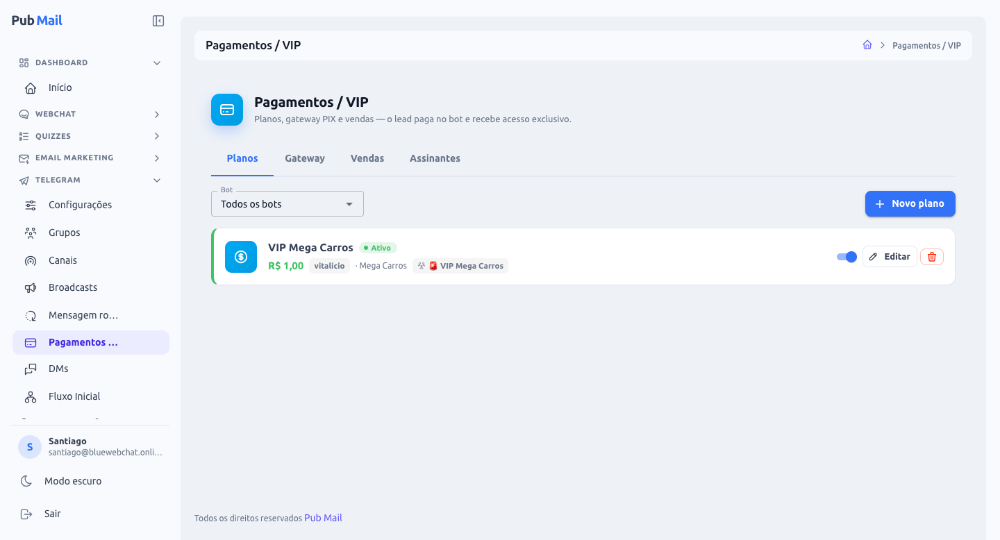

# Módulo Telegram — Pub Mail

Guia completo do módulo **Telegram** do Pub Mail: o que cada tela faz, como configurar e exemplos práticos de uso. Os exemplos usam o bot fictício **Mega Carros** (`@mega_carros_bot`), uma página de ofertas de carros que capta leads, nutre com conteúdo e vende acesso a um grupo VIP.

## Sumário

- [Visão geral](#visão-geral)
- [Conceitos básicos](#conceitos-básicos)
- [Primeiros passos](#primeiros-passos)
- [1. Configurações (bots)](#1-configurações-bots)
- [2. Grupos](#2-grupos)
- [3. Canais](#3-canais)
- [4. DMs (mensagens)](#4-dms-mensagens)
- [5. Fluxo Inicial](#5-fluxo-inicial)
- [6. Automações](#6-automações)
- [7. Broadcasts](#7-broadcasts)
- [8. Mensagem rotativa](#8-mensagem-rotativa)
- [9. Pagamentos / VIP](#9-pagamentos--vip)
- [Exemplo completo: do anúncio à venda](#exemplo-completo-do-anúncio-à-venda)
- [Limites e boas práticas](#limites-e-boas-práticas)
- [Solução de problemas](#solução-de-problemas)
- [Glossário](#glossário)

---

## Visão geral

O módulo transforma bots do Telegram em um canal completo de marketing e vendas, todo operado pelo painel:

| Tela | Para que serve |
|---|---|
| **Configurações** | Cadastrar e gerenciar os bots (tokens, perfil, saúde). |
| **Grupos** | Ver e gerenciar os grupos onde os bots estão. |
| **Canais** | Ver e gerenciar os canais onde os bots são administradores. |
| **DMs** | Conversar em tempo real com leads, grupos e canais. |
| **Fluxo Inicial** | Montar visualmente a conversa que o lead recebe ao dar `/start`. |
| **Automações** | Enviar mensagens programadas depois do `/start` (sequência de nutrição). |
| **Broadcasts** | Disparar mensagens em massa, com agendamento diário e rotação de textos. |
| **Mensagem rotativa** | Prova social: uma mensagem que se atualiza sozinha ("Fulano acabou de entrar no VIP"). |
| **Pagamentos / VIP** | Vender planos via PIX e liberar acesso automático a grupos/canais VIP. |

Tudo é **isolado por organização**: bots, leads, grupos, mensagens e vendas de uma empresa nunca aparecem para outra.

## Conceitos básicos

- **Bot** — a "conta robô" do Telegram que envia e recebe as mensagens. Criado no **@BotFather** (app oficial do Telegram), que entrega um **token** (a senha do bot). O Pub Mail usa esse token para operar o bot.
- **Lead (contato)** — qualquer pessoa que iniciou conversa com o bot (tocou em **Iniciar** / enviou `/start`). **O Telegram só permite que o bot mande mensagem privada para quem falou com ele antes.** Por isso a captação de leads é sempre feita levando a pessoa até o bot.
- **Grupo** — conversa com vários membros. O bot participa e pode postar e ler mensagens.
- **Canal** — lista de transmissão: só administradores postam, os demais só leem. O bot precisa ser **administrador** do canal.
- **Webhook** — o "endereço" para onde o Telegram avisa, em tempo real, que chegou uma mensagem. O Pub Mail configura isso sozinho ao cadastrar o bot.
- **Deep-link** — link do tipo `t.me/mega_carros_bot?start=instagram`. Leva a pessoa ao bot já marcando **de onde ela veio** (`instagram`), o que permite medir campanhas.

## Primeiros passos

Checklist para colocar um bot para funcionar do zero:

1. **Crie o bot no @BotFather:** no Telegram, abra o **@BotFather**, envie `/newbot`, escolha o nome (ex.: *Mega Carros*) e o usuário (ex.: `mega_carros_bot`). Copie o **token** que ele devolve.
2. **Cadastre no Pub Mail:** em **Telegram → Configurações → Adicionar bot**, dê um apelido e cole o token.
3. **Habilite o teste:** no seu Telegram, abra o bot e toque em **Iniciar**. A partir daí, o botão **Enviar teste** passa a funcionar para você.
4. **Grupos:** no @BotFather, desative o **Group Privacy** (`/mybots → seu bot → Bot Settings → Group Privacy → Turn off`) para o bot ler as mensagens do grupo. Depois adicione o bot ao grupo **como administrador**.
5. **Canais:** adicione o bot ao canal como **administrador com permissão de publicar**.
6. **Monte o Fluxo Inicial** e ative-o. Divulgue o **Link de captação**.

> A aba **Ajuda**, em Configurações, mostra esses caminhos do BotFather passo a passo, com o nome exato de cada botão.

---

## 1. Configurações (bots)

É onde ficam **todos os bots** da organização. Cada bot é um remetente independente. A recomendação é **distribuir os bots em contas diferentes do Telegram**: se uma conta for banida, só os bots dela caem, e os demais continuam operando.

### O card do bot

| Elemento | Significado |
|---|---|
| Foto, nome e `@usuario` | Identidade do bot no Telegram. O ícone ao lado do `@` copia o link `t.me/...`. |
| **Status** | **Ativo** (funcionando), **Instável** (não foi possível confirmar; tente revalidar), **Banido** (token revogado ou bot apagado; é **permanente**, precisa cadastrar um token novo) ou **Em pausa** (limite temporário do Telegram; volta sozinho no horário indicado). |
| Token mascarado | Só os primeiros e últimos caracteres aparecem. O token completo nunca é exibido. |
| **Webhook ativo** | Confirma que o Telegram está entregando as mensagens ao Pub Mail. |
| Contadores | Quantos grupos e leads o bot tem. |
| Checado em | Última verificação do bot junto ao Telegram. |

### Ações

- **Enviar teste** — manda uma mensagem de teste para **você**. Requer que você tenha dado `/start` no bot antes.
- **⚙ Configurar bot** — edita o **nome**, o **"Sobre"**, a **descrição** (o texto de "O que este bot pode fazer?") e os **comandos** (ex.: `/vip — Ver planos`). Tem uma aba **Preview** que reproduz a tela de abertura do bot. Foto e privacidade só podem ser alteradas pelo @BotFather; o modal mostra isso.
- **⋮ → Revalidar** — consulta o Telegram de novo e reconfigura o webhook. Use depois de trocar algo no BotFather.
- **⋮ → Editar** — troca o apelido ou o token.
- **⋮ → Excluir** — remove o bot **e tudo que depende dele** (grupos, conversas, fluxos, automações). Leads que também pertencem a outro bot continuam.

**Exemplo:** a Mega Carros tem 3 bots em 3 contas do Telegram diferentes (`@mega_carros_bot`, `@megacarros_ofertas_bot`, `@megacarros_sp_bot`). Se o primeiro entrar **Em pausa** por excesso de envios, os broadcasts dos outros dois continuam normalmente.

## 2. Grupos

Lista os grupos onde os bots da organização estão. **Não é preciso cadastrar nada:** o grupo aparece sozinho assim que o bot recebe uma mensagem nele ou é adicionado.

Cada card mostra a foto, o nome, o tipo (público com `@usuario` ou **privado**), o **número de membros**, o bot que está no grupo, a última atividade e a prévia da última mensagem.

- **Mensagens** — abre a conversa do grupo na tela **DMs**, para ler e postar.
- **Convite** — gera e copia um **link de convite** (o bot precisa ser administrador com permissão de convidar).
- **Sair** (botão vermelho) — faz o bot sair do grupo e remove o grupo do Pub Mail.

Filtros: por **bot** e por **nome** do grupo. O botão **Atualizar** recarrega a lista e a contagem de membros.

**Exemplo:** o grupo **VIP Mega Carros** é privado. Ele aparece aqui depois que o `@mega_carros_bot` é adicionado como administrador, e passa a ficar disponível como destino de broadcasts, da mensagem rotativa e da entrega de acesso nos Pagamentos.

## 3. Canais

Funciona como a tela de Grupos, mas para **canais**. O canal aparece automaticamente quando o bot é promovido a **administrador** dele. Para o bot publicar, dê a ele a permissão **Publicar mensagens**.

Ações: **Mensagens** (abre o canal em DMs para postar), **Convite** e **Sair**. Canais também podem ser destino de broadcasts, da mensagem rotativa e da entrega VIP.

**Exemplo:** o canal **Ofertas Mega Carros** recebe todos os dias às 9h um broadcast com a "oferta do dia", postado pelo bot.

## 4. DMs (mensagens)

Central de conversas no estilo Telegram. Serve para atender leads, acompanhar o que o bot enviou (fluxo, automações, broadcasts) e postar em grupos e canais.

**Coluna da esquerda**
- **Bot** — escolha qual bot visualizar.
- **Busca** — por `@usuario`, número ou nome.
- **Grupos**, **Canais** e **Conversas** — cada item mostra a foto, o nome, o horário e a prévia da última mensagem (**Você:** indica mensagem enviada pelo bot). O ponto verde indica contato ativo recentemente.

**Área da conversa**
- Balões recebidos à esquerda e enviados à direita, com separadores de data e imagens exibidas na própria conversa.
- **Tags** do contato no cabeçalho (aplicadas pelo fluxo ou pelas automações).
- Caixa de mensagem com **emoji** e **anexo de foto**. **Enter** envia.

A tela se atualiza sozinha: a conversa aberta a cada ~3 segundos e a lista a cada ~10 segundos.

**Exemplo:** o lead *Isaac Nogueira* responde "tem SUV até 80 mil?". O atendente abre a conversa em DMs e responde manualmente, pelo próprio bot, sem sair do Pub Mail.

## 5. Fluxo Inicial

É a **conversa automática** que o lead recebe ao tocar em **Iniciar** (`/start`). Cada bot tem **um** fluxo inicial, montado num construtor visual de arrastar e soltar.

### Como a tela funciona

- **Bot** (topo) — escolhe de qual bot é o fluxo.
- **Ativo** — liga ou desliga o fluxo. Desligado, o bot não responde ao `/start`.
- **+ Mensagem** — cria um novo passo.
- **Salvar** — grava o fluxo. O indicador mostra **Salvo**, **Salvando** ou **Alterações não salvas**.
- **Link de captação** — gera o link do bot para divulgar, com um parâmetro opcional de origem (veja [Link de captação](#link-de-captação-deep-link)).
- **Canvas** — o fluxo começa no bloco **Início (/start)**, que liga no primeiro passo. Cada **passo** é um balão com uma ou mais mensagens; as setas mostram o caminho. Clique num passo para editá-lo no painel lateral. Use o mouse para mover o canvas e o zoom (+ / − / ajustar) no canto.

### Blocos disponíveis

Arraste um bloco da coluna **Blocos** para o canvas (cria um passo novo) ou **para cima de um passo existente** (adiciona ao passo).

| Grupo | Bloco | O que faz |
|---|---|---|
| Mensagens | **Texto** | Mensagem de texto. Aceita variáveis como `{{nome}}`. |
| Mensagens | **Imagem / Vídeo / Documento** | Envia mídia, com texto opcional como legenda. |
| Mensagens | **Áudio** | Envia áudio como **mensagem de voz**. Dá para gravar direto no navegador. |
| Mensagens | **Atraso / Digitando…** | Mostra "digitando…" por 0 a 10 segundos antes da mensagem, deixando a conversa mais humana. |
| Entradas | **Botões** | Botões abaixo da última mensagem do passo (veja as ações abaixo). |
| Entradas | **Resposta por texto** | Leva a um caminho diferente conforme o lead **digita** uma palavra-chave. |
| Lógica | **Aplicar tag** | Marca o lead com tags (ex.: `interessado-suv`), visíveis em DMs. |
| Lógica | **Redirecionar** | Botão que abre um link externo. |
| Vendas | **Vender plano (checkout)** | Botão que inicia a compra de um plano via PIX (veja [Pagamentos / VIP](#9-pagamentos--vip)). |

**Ações de botão**

| Ação | Resultado ao tocar |
|---|---|
| **Próximo passo** | Segue para o passo ligado por aquele botão no canvas. |
| **Abrir link** | Abre uma URL. |
| **Entrar no grupo** / canal | Abre o convite do grupo ou canal escolhido (grupos privados geram link de convite automaticamente). |
| **Ir para outro bot** | Abre outro bot seu. |
| **Vender plano** | Inicia o checkout PIX do plano escolhido. |

**Resposta por texto:** cada resposta tem uma palavra-chave (ex.: `suv`) e leva a um passo próprio. A saída **Qualquer resposta** captura o que não bateu com nenhuma palavra-chave.

### Variáveis

Use nas mensagens do fluxo, das automações e dos broadcasts. São substituídas pelos dados de cada lead.

| Variável | Vira |
|---|---|
| `{{nome}}` | Primeiro nome do lead. |
| `{{sobrenome}}` | Sobrenome. |
| `{{username}}` | `@usuario` do lead. |
| `{{origem}}` (ou `{{start_param}}`) | O parâmetro do link de captação (ex.: `instagram`). |

### Link de captação (deep-link)

O botão **Link de captação** gera `https://t.me/mega_carros_bot` e, se você preencher um **parâmetro**, `https://t.me/mega_carros_bot?start=instagram`. O parâmetro fica gravado no lead e pode ser usado em `{{origem}}`. Crie um link por canal de divulgação para saber de onde vêm os leads:

- Bio do Instagram → `?start=instagram`
- Anúncio no Facebook → `?start=fb-ads-setembro`
- Vídeo no YouTube → `?start=youtube`

### Exemplo (o fluxo da tela acima)

1. **Início (/start)** → **Passo 1:** "digitando…" por 1s, imagem da Mega Carros e o texto *"Olá, {{nome}}! Eu sou o Pablo, consultor da Mega Carros…"*, com o botão **Quero mais informações**.
2. O botão leva ao **Passo 2:** três mensagens em sequência, cada uma com "digitando…" de 2s: boas-vindas, a prova ("nossos membros receberam mais de 20 ofertas abaixo da FIPE…") e a chamada para o VIP. Termina com o botão **Entrar no grupo VIP** (ou **Vender plano**, para cobrar o acesso).

## 6. Automações

Segunda aba da tela **Fluxo Inicial**. São mensagens **programadas no tempo**, enviadas depois que o lead dá `/start`, para nutrir e recuperar quem não avançou.

- Cada bot pode ter **várias automações**, cada uma com **vários passos**.
- **Atraso** de cada passo, em minutos, horas ou dias. O 1º passo conta a partir do `/start`; os seguintes contam a partir do passo anterior.
- **Conteúdo**: texto, mídia, botões (inclusive **Vender plano**) e tags.
- **Condição** por passo:
  - **Sempre** — envia de qualquer jeito.
  - **Só se inativo** — envia apenas se o lead **não mandou nenhuma mensagem** desde o `/start`. Se a condição falhar, dá para **pular o passo** ou **encerrar a automação** para aquele lead.
- A lista mostra uma linha do tempo de cada automação ("Lead dá /start → após 1h → …") e uma prévia no estilo Telegram ao lado do editor.

**Exemplo — recuperação de quem não comprou:**

| Quando | Condição | Mensagem |
|---|---|---|
| 1 hora após o `/start` | Só se inativo | "{{nome}}, separei 3 ofertas de hoje pra você 👇" + botão **Ver ofertas** |
| 1 dia depois | Sempre | Depoimento de um membro VIP + botão **Entrar no VIP** (Vender plano) |
| 3 dias depois | Só se inativo (senão encerra) | "Última chamada: o VIP fecha hoje às 23h" |

## 7. Broadcasts

Disparos **em massa** para **DMs, grupos e canais**, de um ou vários bots, com **agendamento diário** e **rotação de textos** (as *copies*).

### A lista

Cada broadcast mostra o nome, o status (**Ativo/Inativo**), a **audiência estimada** (quantas DMs, grupos e canais), o modo (**sequencial** ou **aleatório**), o número de copies e os **horários**. A bolinha em cada horário mostra o **status de hoje**:

| Indicador | Significado |
|---|---|
| ✅ verde | Enviado com sucesso. |
| ⚠ âmbar | Enviado, mas com falhas em parte da audiência. |
| ❌ vermelho | Executou e falhou. |
| 🕐 amarelo | Aguardando o horário. |
| Azul girando | Enviando agora. |
| Cinza | Não rodou hoje (ex.: estava desativado). |

**Ações:** chave liga/desliga · **Disparar** (envia agora, com confirmação da audiência) · **Copies** · **Editar** · **Histórico** · **Excluir**. Há filtros por nome, bots, grupos e horário.

### Criando um broadcast

1. **Bots** — um ou mais. Com vários bots, cada bot envia para os próprios leads.
2. **Audiência** — **DMs** (todos os leads dos bots escolhidos) e/ou **grupos** e **canais** específicos. A estimativa de audiência é recalculada enquanto você edita.
3. **Horários** — um ou mais horários **diários**, no horário de Brasília.
4. **Modo** — **Sequencial** (a cada disparo usa a próxima copy) ou **Aleatório** (sorteia uma copy). Opção **apagar a copy usada** (cada texto sai uma única vez).

### Copies

Cada copy é uma **sequência de mensagens** (texto, mídia, atraso de digitação) com **pré-visualização no estilo Telegram**. Em cada mensagem dá para:
- inserir **variáveis** com um clique (`{{nome}}` etc.; em grupos e canais elas ficam vazias);
- adicionar até **6 botões**: link, grupo, canal, outro bot ou **Vender plano**.

### Histórico

Lista cada disparo com filtros de status e período (hoje, 7 ou 30 dias), paginação e uma barra de proporção de **enviados / bloqueados / falhas**, com o percentual entregue. **Bloqueado** = o lead bloqueou o bot.

**Exemplo:** o broadcast **VIP Mega Carros** envia às **16:00 e 18:00** para o grupo VIP, em modo **aleatório** entre 3 copies ("🔥 Oferta relâmpago…", "📉 Sabia que o melhor mês pra comprar carro usado…", "🚗 Chegou agora…"). O **Convite VIP Mega Carros** envia às **17:00** para as DMs, com o botão **Quero entrar no VIP**.

## 8. Mensagem rotativa

Recurso de **prova social**: o bot publica **uma única mensagem** e vai **trocando o texto dela sozinho**, sem encher o chat. Exemplo: *"🔥 Marcos acabou de entrar no VIP"* vira, pouco depois, *"🔥 Juliana acabou de entrar no VIP"*.

### Configuração

- **Destino**: um **grupo**, um **canal** ou **"O próprio bot" (DMs)**. Em DMs, cada lead tem a própria mensagem rotativa, mantida sempre como a **última mensagem** da conversa.
- **Textos**: um por linha. Use `{{nome}}` para sortear um nome da **lista de nomes**.
- **Nomes para sortear**: a lista usada em `{{nome}}` (prova social = outras pessoas, nunca o nome do próprio lead).
- **Intervalo** e **modo** (sequencial ou aleatório).
- **Ativo**: chave na lista.

### Proteções automáticas

Para não ser punido pelo Telegram por excesso de edições, o sistema aplica limites mesmo que o intervalo configurado seja menor:

- intervalo mínimo real de **10 s** em grupos e canais e de **30 s** em DMs;
- em DMs, **no máximo 10 edições por hora por lead**, espaçadas ao longo da hora;
- se o lead **bloqueia o bot ou sai do Telegram**, a rotativa **para** para ele (volta sozinha se ele interagir de novo);
- se o Telegram pedir pausa, o bot **respeita o tempo pedido** antes de tentar de novo.

**Exemplo:** rotativa nas **DMs do bot** Mega Carros, com o texto *"✅ {{nome}} acabou de garantir o acesso VIP"* e 40 nomes na lista. Todo lead que conversa com o bot vê essa mensagem no fim da conversa, sempre com um nome diferente.

## 9. Pagamentos / VIP

Venda de **acesso a grupos e canais VIP** direto no Telegram, com **PIX** e liberação **automática**.

### Como o comprador vive a compra

1. Toca num botão **Vender plano** (no fluxo, numa automação ou num broadcast) ou envia **`/vip`** (também `/planos` ou `/comprar`) para ver os planos.
2. Escolhe o plano. O bot envia, **no privado**, o **QR Code** e o **PIX copia-e-cola**, com um botão para **copiar o código**. A cobrança vale **30 minutos**.
3. Paga no app do banco e toca em **✅ Já paguei**. O Pub Mail **confere o pagamento direto no gateway** (um aviso falso não libera nada). Se ainda não caiu, o bot avisa e oferece verificar de novo.
4. Confirmado: o bot envia um **link de convite de uso único** (vale 3 dias) para o grupo ou canal VIP, mais a mensagem de boas-vindas configurada.
5. Se a cobrança expirar ou for cancelada, aparece o botão **Gerar novo PIX**, sem precisar recomeçar.

A confirmação também chega sozinha pelo **webhook do gateway** e por uma verificação automática a cada minuto: o lead recebe o acesso mesmo que não toque em "Já paguei".

### Aba Planos

Cada plano tem: **nome**, **bot**, **valor** (R$), **descrição**, **grupo/canal de entrega**, **mensagem e mídia de entrega**, **duração** e **ativo**.

- **Duração 0 = vitalício** (acesso para sempre).
- **Duração > 0 = assinatura** (ex.: 30 dias). O Pub Mail:
  - avisa o assinante **2 dias antes** de vencer, com botão de renovação;
  - no vencimento, **remove o assinante do grupo/canal VIP** e envia o botão **🔓 Renovar**;
  - ao renovar, **estende** a assinatura e envia um novo convite.

### Aba Gateway

- **Provedor**: **Mercado Pago** ou **PushinPay**.
- **Token** do gateway (fica salvo mascarado) e **Testar conexão**.
- **URL de webhook**: copie e cadastre no painel do gateway para a confirmação ser instantânea.
- **Cobranças ativas**: desligado, o bot para de gerar novos PIX.
- **Mensagens do checkout**: todo o texto é configurável. Instrução (com `{plano}` e `{valor}`), enviar ou não o QR Code, PIX em mensagem separada, texto do botão de copiar, rótulos **Já paguei** e **Cancelar**, e as mensagens de **"ainda não identificamos"** e **"cobrança expirada"**.

### Abas Vendas e Assinantes

- **Vendas** — todas as cobranças, com status (pendente, pago, expirado, falhou), filtros por bot e status, e o total da **receita confirmada**.
- **Assinantes** — assinaturas ativas e vencidas, com a data de vencimento de cada uma e o contador de ativos.

**Exemplo:** plano **VIP Mega Carros — Mensal**, R$ 29,90, 30 dias, entrega no grupo **VIP Mega Carros**. O lead compra pelo botão do fluxo, entra no grupo pelo convite, recebe o lembrete 2 dias antes do vencimento e, se não renovar, é removido do grupo automaticamente.

---

## Exemplo completo: do anúncio à venda

1. **Anúncio** no Instagram com o link `t.me/mega_carros_bot?start=insta-set`.
2. O lead toca em **Iniciar** e recebe o **Fluxo Inicial**: apresentação, ofertas e o botão **Entrar no VIP (R$ 29,90)**. O fluxo aplica a tag `origem-instagram`.
3. Não comprou? A **Automação** manda ofertas depois de 1 hora e um depoimento no dia seguinte.
4. Todo dia às 17h o **Broadcast** convida os leads para o VIP; às 16h e às 18h o grupo VIP recebe ofertas exclusivas.
5. A **Mensagem rotativa** mostra nas DMs que outras pessoas estão entrando no VIP.
6. O lead compra via **PIX**, recebe o **convite de uso único** e entra no grupo. Tudo sem intervenção manual.
7. O atendimento continua em **DMs**, e as vendas e renovações aparecem em **Pagamentos / VIP**.

## Limites e boas práticas

- **Respeite os limites do Telegram.** Excesso de envios ou edições gera uma **pausa temporária** (flood-wait), que pode durar horas. O Pub Mail respeita essas pausas sozinho e mostra **Em pausa** no card do bot com o horário de retorno. Nada precisa ser feito além de aguardar.
- **Distribua a audiência em vários bots, em contas diferentes.** Um banimento derruba apenas os bots daquela conta.
- **Broadcasts**: cada bot envia até ~25 mensagens por segundo. Leads que bloquearam o bot são marcados como **bloqueados** e não contam como falha técnica.
- **Permissões**: nos grupos, desative o **Group Privacy** no BotFather e dê administrador ao bot. Nos canais, o bot precisa ser administrador com permissão de **publicar**.
- **Qualidade > volume**: mensagens relevantes, com poucos disparos por dia, reduzem bloqueios e denúncias, que são o que mais leva a banimentos.

## Solução de problemas

| Problema | O que fazer |
|---|---|
| O bot não responde ao `/start`. | Veja se o **Fluxo Inicial** está **Ativo** e salvo. Em **Configurações**, confira se o bot está **Ativo** e com **Webhook ativo**; se não, use **⋮ → Revalidar**. |
| O card mostra **Em pausa**. | Limite temporário do Telegram. Aguarde o horário indicado; o envio volta sozinho. |
| O card mostra **Banido**. | O token foi revogado ou o bot foi apagado. Crie um token novo no @BotFather e use **⋮ → Editar**. |
| **Enviar teste** não funciona. | Abra o bot no seu Telegram e toque em **Iniciar** antes. |
| O grupo não aparece. | Adicione o bot como administrador, desative o **Group Privacy** e envie uma mensagem no grupo. |
| O canal não aparece. | Promova o bot a administrador do canal. |
| O convite do grupo não funciona. | O bot precisa ser administrador **com permissão de convidar usuários**. |
| O PIX não confirma. | Confira o token em **Gateway → Testar conexão** e a **URL de webhook** no painel do gateway. A verificação automática por minuto também confirma. |
| Os broadcasts não chegam a alguns leads. | Veja o **Histórico**. **Bloqueados** são leads que bloquearam o bot; **falhas** mostram o motivo do erro. |

## Glossário

| Termo | Definição |
|---|---|
| **@BotFather** | Bot oficial do Telegram para criar e configurar bots. |
| **Token** | A credencial do bot. Quem tem o token controla o bot; nunca compartilhe. |
| **`/start`** | Comando enviado quando a pessoa toca em **Iniciar**. Marca o início da conversa e autoriza o bot a mandar mensagens para ela. |
| **Deep-link** | Link `t.me/bot?start=parametro`, usado para rastrear a origem do lead. |
| **Copy** | Uma variação de texto de um broadcast. |
| **Flood-wait** | Pausa temporária imposta pelo Telegram por excesso de envios. |
| **Webhook** | Aviso automático que o Telegram (ou o gateway de pagamento) envia ao Pub Mail quando algo acontece. |
| **Prova social** | Mostrar que outras pessoas estão comprando, para incentivar a decisão. |
